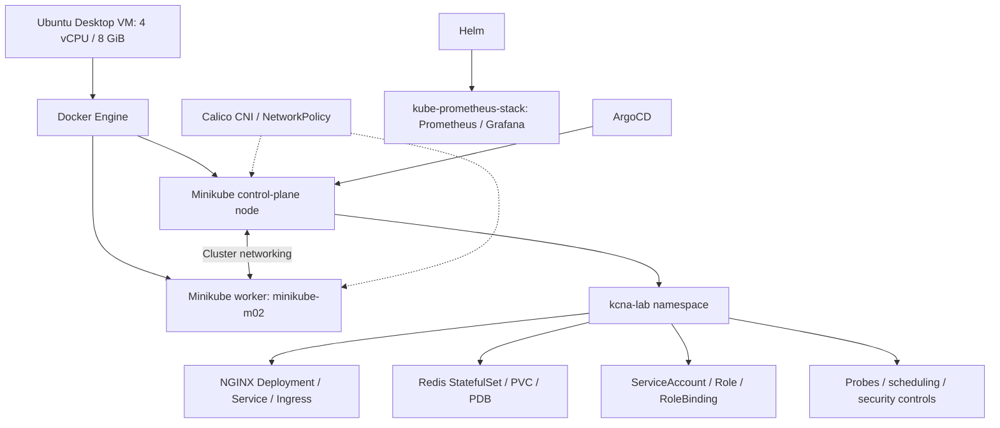

# KCNA Multi-Node Minikube Hands-On Lab

**Kubernetes and Cloud Native Associate (KCNA) practical portfolio lab** | Ubuntu Desktop VM | 2-node Minikube | Docker driver | Calico CNI

> **Status: lab plan and reproducible reference material, not a claim of completed hands-on exercises.** This repository is aligned to the user's *KCNA Minikube Hands-On Lab Guide* (six phases, approximately 120 minutes). Completion evidence will be added as exercises are performed.

## Lab environment

| Item | Target |
| --- | --- |
| Host | Ubuntu Desktop 22.04/24.04 LTS virtual machine |
| Resources | 4 vCPUs, 8 GiB RAM, at least 40 GiB free disk |
| Cluster | Two Minikube nodes: `minikube` and `minikube-m02` |
| Driver / CNI | Docker / Calico (for NetworkPolicy enforcement) |
| Tooling | Docker Engine, kubectl, Minikube, Helm |
| Estimated duration | 120 minutes across six sequential phases |

## Architecture



## Curriculum roadmap

| Phase | Focus | Time | Evidence to collect |
| --- | --- | --- | --- |
| 1 | Docker, kubectl, Helm, two-node Minikube + Calico | 15 min | `kubectl get nodes -o wide`, Calico pod status |
| 2 | Pods, ImagePullBackOff troubleshooting, Deployments, rollouts, DaemonSets, Jobs | 25 min | Pod events, rollout history, DaemonSet/Job output |
| 3 | ConfigMaps, Secrets, labels, annotations, startup/liveness/readiness probes | 20 min | Pod description, probe status, redacted environment evidence |
| 4 | Taints, tolerations, affinity, Redis StatefulSet, dynamic PVCs, PDB | 20 min | Node placement, PVC binding, PDB status |
| 5 | Kubernetes API, ServiceAccounts/RBAC, security contexts, PSA, ResourceQuota | 20 min | `kubectl auth can-i`, quota and restricted Pod status |
| 6 | Services, Ingress, Gateway API CRDs, Calico NetworkPolicy, Kustomize, Helm, Prometheus/Grafana, ArgoCD | 20 min | Allowed/denied connectivity tests, Helm release, dashboards |

**Source:** uploaded *KCNA Minikube Hands-On Lab Guide*, pages 1–16. See [phase-by-phase workbook](docs/kcna-lab-plan.md) and [evidence checklist](docs/kcna-evidence-checklist.md).

## Start the cluster

```bash
# Install Docker, kubectl, Minikube and Helm first, following the workbook.
minikube start --nodes 2 --cpus 2 --memory 3072 --driver=docker --cni=calico
kubectl get nodes -o wide
kubectl get pods -n kube-system -l k8s-app=calico-node
kubectl create namespace kcna-lab
kubectl config set-context --current --namespace=kcna-lab
```

**Resource note:** With an 8 GiB host VM, running kube-prometheus-stack and ArgoCD alongside all exercises may require additional resources, cleanup, or staged installation. Treat the two-hour schedule as an estimate, not a benchmark.

## Exercises

- [Phase-by-phase commands and concepts](docs/kcna-lab-plan.md)
- [Lab evidence checklist](docs/kcna-evidence-checklist.md)
- [Networking and policy considerations](docs/kcna-networking-notes.md)
- [Existing NGINX + exporter + Prometheus demo](k8s/) — **optional extension**, not the workbook's kube-prometheus-stack installation
- [Original observability design decisions](docs/architecture-decisions.md)
- [Original observability verification](docs/verification.md)

### Important differences from the optional demo

The KCNA workbook uses **Calico**, a **two-node cluster**, **Redis StatefulSet**, **namespace-scoped RBAC**, **Helm-installed kube-prometheus-stack with Grafana**, and **ArgoCD**. The existing `k8s/` demo uses a standalone Prometheus deployment and NGINX exporter, with CPU-based HPA; it remains available for extra practice but is not a substitute for the workbook.

## Security and reproducibility

- Never commit the workbook's example Secret values, real credentials, Grafana passwords, or ArgoCD initial admin passwords.
- Keep the local Kubernetes API proxy and dashboard port-forwards bound to localhost.
- Gateway API CRDs alone do **not** install a Gateway controller.
- A NetworkPolicy that only permits traffic from `access=granted` pods may block the ingress controller; document or explicitly allow controller traffic if testing external ingress.
- A Redis PDB limits voluntary disruption but does not itself guarantee Redis replication, persistence or high availability.
- Record observed output rather than describing unperformed steps as completed.

## Portfolio completion criteria

Capture redacted screenshots or terminal transcripts of both nodes Ready, Calico running, rollout history, probe checks, Redis PVC/PDB, RBAC allow/deny results, restricted Pod admission, NetworkPolicy allow/deny tests, Prometheus/Grafana and ArgoCD interfaces. Record software versions and any deviations from the guide.

**Author:** Darian O'Dirling · Enterprise Solutions Architect portfolio.
