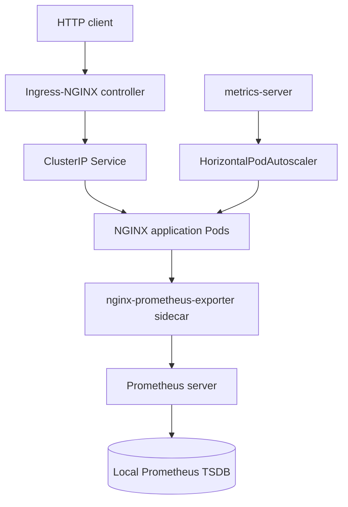

# Minikube NGINX + Prometheus Observability

A runnable **local Kubernetes reference architecture** demonstrating NGINX ingress, autoscaled NGINX application pods, Prometheus scraping, and a Prometheus time-series database.

> **Lab scope:** designed for Minikube. Validate cluster-specific image, add-on, networking, resource and security settings before production use. The configuration has not been executed against a live cluster in this session.

## Architecture



## Prerequisites

- Docker or another supported Minikube driver; Minikube, kubectl, and enough local resources (~4 CPUs and 6 GiB RAM recommended).
- `minikube addons enable ingress` and `minikube addons enable metrics-server`.
- A reachable Minikube cluster: `kubectl get nodes`.

## Quick start

```bash
minikube start --cpus=4 --memory=6144
minikube addons enable ingress
minikube addons enable metrics-server
kubectl apply -k k8s/
kubectl -n observability-demo rollout status deploy/nginx-app
kubectl -n observability-demo rollout status deploy/prometheus
kubectl -n observability-demo get pods,svc,ingress,hpa
```

### Access NGINX

Add `127.0.0.1 nginx.demo.local` to your hosts file **when using the ingress port-forward method** below. Run:

```bash
kubectl -n ingress-nginx port-forward service/ingress-nginx-controller 8080:80
curl -H 'Host: nginx.demo.local' http://127.0.0.1:8080/
```

Depending on your Minikube driver/OS, direct Minikube ingress access may differ. The port-forward above avoids assuming the Minikube IP is reachable.

### Inspect Prometheus

```bash
kubectl -n observability-demo port-forward service/prometheus 9090:9090
# Open http://127.0.0.1:9090
```

Try PromQL: `up{job="nginx"}` and `nginx_http_requests_total`. The NGINX exporter reads `stub_status` at `http://127.0.0.1:8081/stub_status` inside each pod.

### Autoscaling demo

```bash
kubectl -n observability-demo get hpa -w
kubectl -n observability-demo run load --image=busybox:1.36 --restart=Never -- /bin/sh -c 'while true; do wget -q -O- http://nginx-app >/dev/null; done'
kubectl -n observability-demo delete pod load
```

The HPA scales on **CPU utilization**, not Prometheus metrics. NGINX may not consume enough CPU from a single load pod to trigger scaling; use a suitable load generator and observe metrics-server readings. The exporter provides request and connection metrics for monitoring.

## Contents

- `k8s/`: Kustomize, namespace, NGINX config/deployment/service/ingress, HPA, Prometheus RBAC/config/deployment/service
- `docs/`: architecture choices, verification and troubleshooting
- `scripts/validate.py`: offline manifest checks
- `.github/workflows/validate.yml`: CI syntax/structural validation

## Design limitations

- Prometheus uses `emptyDir` storage: data is lost when the pod is replaced.
- No Alertmanager, Grafana, authentication, TLS, durable PVC, high availability, network policies, or production hardening.
- Prometheus service account can list pods for service discovery only.
- Ingress host is local lab DNS; never expose the Prometheus UI to the public internet without authentication and TLS.
- Exporter metric names depend on exporter release.

**Author:** Darian O'Dirling · Enterprise Solutions Architect portfolio.
